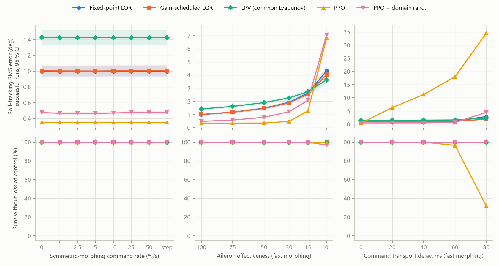

# morphing-flight-jax

[](https://github.com/jihoonlee91/morphing-flight-jax/actions/workflows/ci.yml)
[](LICENSE)
[](https://doi.org/10.3390/s23063075)

A differentiable JAX re-implementation of an asymmetric span-morphing UAV built on NASA's
Generic Transport Model (GTM-T2), and a paired evaluation of three model-based flight
controllers and a reinforcement-learning policy under fast morphing, model error, sensor noise,
command delay, and aileron failure.

The aircraft model and the LPV design come from my paper
[*Self-Scheduled LPV Control of Asymmetric Variable-Span Morphing UAV*](https://doi.org/10.3390/s23063075)
(Sensors, 2023), originally in MATLAB/Simulink
([`gtm-lpv-control`](https://github.com/jihoonlee91/gtm-lpv-control)). This repository ports it to
JAX and asks a question the paper did not: on the same aircraft, what does a learned controller
buy, and what does it cost?

## Results

Lateral-directional control (aileron, rudder, and asymmetric wing span) tracking random bank
commands for 15 s at 70–110 kt and 500–9,500 ft. Every controller flies the **same 256
scenarios per condition** (common random numbers), so differences between rows are paired
comparisons. PPO rows pool 3 training seeds (768 runs per cell).

| Controller | Frozen shape | Fast morphing | + noise, 40 ms delay | + model error | + aileron at 0–30 % |
|---|---:|---:|---:|---:|---:|
| Fixed-point LQR | 1.05° | 1.01° | 1.07° | 1.05° | 2.75° |
| Gain-scheduled LQR | 1.06° | 1.02° | 1.07° | 1.06° | 2.64° |
| LPV (common Lyapunov) | 1.50° | 1.45° | 1.55° | 1.51° | 2.74° |
| PPO | **0.35°** | **0.35°** | 11.6° | **0.36°** | **1.81°** |
| PPO + domain randomization | 0.49° | 0.48° | **0.56°** | 0.50° | 2.66° |

Roll-tracking RMS error. All controllers keep control in 100 % of runs except the PPO variants
under aileron failure (99.7 %). 95 % bootstrap intervals span ±2–10 % of each value
([`results/metrics.json`](results/metrics.json)); the full table, sideslip, and actuator
activity are in [`results/results.md`](results/results.md).



**What the numbers say**

1. **Morphing speed does not matter for lateral control on this airframe.** Every controller is
   flat from a frozen shape to step changes of the symmetric span (left column). Symmetric
   morphing mostly moves the longitudinal axis; the shared longitudinal hold absorbs it. The
   paper's motivating failure (a fixed design diverging under fast morphing) does not reproduce in
   this lateral task, and the evaluation says so rather than hiding it.
2. **PPO tracks 3× tighter than a tuned LQR** (0.35° vs 1.05°) and degrades more gracefully when
   the aileron loses effectiveness, because it leans harder on asymmetric morphing (RMS
   asymmetric span 2.0 % vs 1.4 % with the aileron at 0–30 %).
3. **…and falls apart with 20 ms of command delay.** At 40 ms plus sensor noise its error is
   33× the nominal value, and at 80 ms it loses control in 68 % of runs (right column). The LQR,
   tuned under a 60 ms delay-margin requirement, barely moves.
4. **Domain randomization buys the robustness back** for a 40 % increase in nominal error
   (0.49°), and it cuts actuator activity from 0.56 to 0.16 limit-normalized travel per second, close
   to the LQR's 0.13. Nominal PPO's tight tracking comes partly from a chattering limit cycle
   ([example](results/figures/example_rollout.png)).
5. **The LPV design pays about 40 % in nominal tracking for its certificate**: one Lyapunov matrix
   that proves stability for arbitrarily fast parameter variation at all 63 design points. With
   no aileron at all it is the most accurate controller (3.6° vs 4.1° LQR and 6.9° PPO).
6. **Tuning the baseline matters as much as the method.** The LQR tuned on PPO's own reward
   scores 485 vs PPO's 495 on the training distribution; dropping the delay-margin requirement
   gets the LQR to 495 too, level with PPO, but with a loop that loses stability with one sample
   of delay. Most of PPO's nominal edge is the same trade.

## What is in here

| | |
|---|---|
| **Aircraft model** ([`aero.py`](src/morphjax/aero.py), [`airframe.py`](src/morphjax/airframe.py), [`dynamics.py`](src/morphjax/dynamics.py)) | 6-DOF rigid body with NASA GTM-T2 aerodynamic tables (basic airframe, elevator, ailerons, mirrored rudder, rate damping with Kalviste rotary-balance blending), the span-morphing mass and aerodynamic model of the paper, first-order actuators (5 Hz surfaces, 0.5 Hz morphing), and an engine map. Pure JAX: `jit`, `vmap`, and `grad` through everything. |
| **Trim and linearization** ([`trim.py`](src/morphjax/trim.py)) | Damped Newton trim on exact autodiff Jacobians (residual ~1e-15) and `jax.jacfwd` linear models, replacing Simulink `trim`/`linmod`. All 63 design points trim and linearize in one `vmap` call (~8 s on a laptop CPU, mostly compilation). |
| **Model-based control** ([`design.py`](src/morphjax/design.py), [`control.py`](src/morphjax/control.py)) | LQR at one point and gain-scheduled over the grid; guaranteed-cost LPV state feedback with a common Lyapunov matrix and a pole-radius constraint, solved as LMIs with CVXPY/Clarabel and re-verified numerically after the solve; sampled-data delay-margin analysis. |
| **Reinforcement learning** ([`rl.py`](src/morphjax/rl.py)) | PPO from scratch in JAX (no RL library): one `lax.scan` collects 64 parallel episodes, GAE, clipped objective, Optax. ~40k environment steps/s on CPU; 12.8 M steps per seed in ~10 min. |
| **Evaluation** ([`evaluation.py`](src/morphjax/evaluation.py), [`scripts/evaluate.py`](scripts/evaluate.py)) | Paired scenarios, bootstrap confidence intervals, stress sweeps, and an actuator-activity metric so that chattering cannot hide behind a good RMS error. |
| **Tests** ([`tests/`](tests)) | 38 tests: interpolation against SciPy, mass properties against numbers in the paper, Jacobians against finite differences, closed-loop stability at every design point, the LMI certificate, determinism, GAE against a reference loop. |

## Reproduce

Requires [uv](https://docs.astral.sh/uv/). The NASA table file (1.1 MB) is downloaded on first
use from [`nasa/GTM_DesignSim`](https://github.com/nasa/GTM_DesignSim) at a pinned commit and
checked against a SHA-256 digest; it is not redistributed here.

```bash
uv sync
uv run pytest                                              # ~1 min
uv run python scripts/tune_lqr.py                          # ~10 min, writes results/lqr_weights.json
uv run python scripts/train_ppo.py --variant nominal --seed 0   # ~10 min per seed; seeds 0-2
uv run python scripts/train_ppo.py --variant dr --seed 0        # domain randomization; seeds 0-2
uv run python scripts/evaluate.py                          # ~6 min, writes results/ and figures
```

Trained policies (`results/policies/*.npz`, with learning curves in the matching `.json`) are
committed, so `evaluate.py` reproduces the table without retraining. Training runs on CPU only.

## Design notes

- **Fair baselines.** The LQR weights are tuned by grid search on the PPO training distribution
  with the PPO reward ([`scripts/tune_lqr.py`](scripts/tune_lqr.py)), with scenario seeds disjoint
  from evaluation. On a nominal model the return keeps rising with loop gain, so the search is
  constrained the way flight-control gains are in practice: every frozen design point must stay
  stable with 60 ms of transport delay (a sampled-data stand-in for a phase-margin rule). The
  untuned LQR, the constrained optimum, and the unconstrained optimum are all in
  [`results/lqr_weights.json`](results/lqr_weights.json).
- **Same information.** The policy sees exactly what the LQR sees (lateral deviation state plus
  airspeed, altitude, and symmetric span) and commands around the same scheduled trim. The
  longitudinal airspeed/altitude hold is a shared gain-scheduled LQR, so the comparison isolates
  the lateral design.
- **One linearization caveat.** The tables are piecewise linear and trim sits on breakpoints
  (sideslip and body rates are zero), so Jacobians are one-sided there, as in Simulink. A
  finite-difference test exposed that `jnp.clip` has a gradient of 0.5 at its bounds, which had
  silently halved every rate-damping derivative; [`interp.py`](src/morphjax/interp.py) avoids it
  and a regression test pins it.
- **What the LPV guarantee does and does not cover.** The common Lyapunov matrix certifies the
  gridded linear models for arbitrarily fast parameter motion. It does not cover the space
  between grid points, actuator saturation, or delay; the evaluation measures those instead.
  The single nominal-point LQR, by contrast, is not even stabilizing at one corner of the grid
  (60 kt, sea level, both tips retracted), which the test scenarios happen not to visit.

## Fidelity to the original model

Ported from NASA GTM_DesignSim and the MATLAB code of the paper: the aerodynamic build-up of the
undamaged aircraft, the hybrid Kalviste blending (`hykal.m`), the mirrored rudder and aileron
tables, the 25 % "wingtip off" damage data reinterpreted as a retracted tip (Eqs. 41–43), and the
mass model (Eqs. 24–39). Two places differ from the MATLAB code, both toward the equations as
printed: the tip's fore-aft travel uses the sweep angle of Eq. (24) (the code used the dihedral
angle; `Airframe(tip_x_uses_sweep=False)` restores it and reproduces the paper's 0.23 % MAC
figure), and the body's own parallel-axis term is kept in Eq. (35) so that an unmorphed wing
returns the NASA inertia exactly.

Simplified relative to GTM_DesignSim: no sensor models (optional Gaussian noise instead), no
landing gear, spoilers, or flaps, a static engine map with a first-order lag, and actuators
without rate limits or dead zones. Morphing is quasi-static, as in the paper.

## Layout

```
src/morphjax/   data.py interp.py aero.py airframe.py atmosphere.py dynamics.py trim.py
                design.py control.py sim.py scenarios.py rl.py evaluation.py pipeline.py
scripts/        tune_lqr.py train_ppo.py evaluate.py figures.py
tests/          one file per module
results/        metrics.json results.md lqr_weights.json figures/ policies/
```

## Citation

If this code is useful, please cite the paper (see [`CITATION.cff`](CITATION.cff)):

```bibtex
@article{lee2023morphing,
  title   = {Self-Scheduled {LPV} Control of Asymmetric Variable-Span Morphing {UAV}},
  author  = {Lee, Jihoon and Kim, Seong-Hun and Lee, Hanna and Kim, Youdan},
  journal = {Sensors},
  volume  = {23},
  number  = {6},
  pages   = {3075},
  year    = {2023},
  doi     = {10.3390/s23063075}
}
```

## License

Code: [MIT](LICENSE). The GTM-T2 aerodynamic database is NASA's, released with
[GTM_DesignSim](https://github.com/nasa/GTM_DesignSim) under the NASA Open Source Agreement; this
repository downloads it at run time and does not redistribute it.
