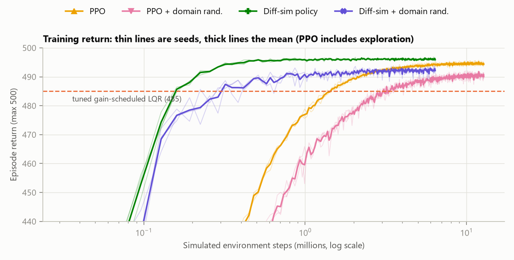
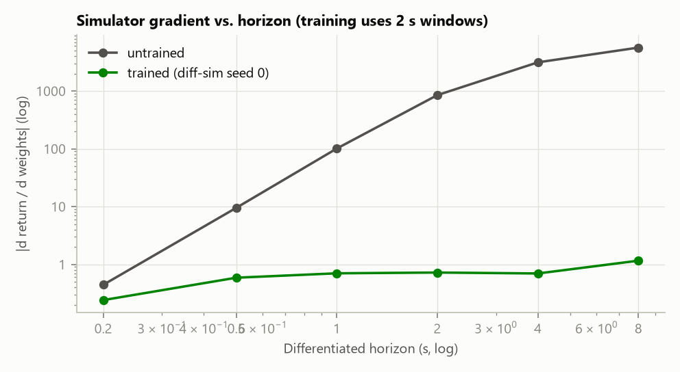

# morphing-uav-jax

[](https://github.com/jihoonlee91/morphing-uav-jax/actions/workflows/ci.yml)
[](LICENSE)
[](https://doi.org/10.3390/s23063075)

**One differentiable JAX flight simulator, three ways to get a controller from it.** The
simulator is a morphing UAV built on NASA's Generic Transport Model. The three routes are
certified model-based design (LQR and LPV), model-free RL (PPO), and gradients through the
simulator itself. All of them fly the same scenarios under fast morphing, model error, sensor
noise, command delay, and actuator failure.

- **Backpropagating through the simulator beats PPO.** It tracks tighter (0.22° vs 0.35° roll
  RMS error) and reaches PPO's training return with about **13× fewer simulated steps**
  (0.33 M vs 3.8–4.9 M).
- **Learned policies' nominal edge is a delay-margin trade, and a linear check predicts the
  cliff.** An LQR tuned without a delay-margin requirement matches PPO exactly: training return
  494.8 vs 494.8, roll error 0.36° vs 0.35°. Linearizing each policy with `jax.jacfwd` shows that
  none of the nominally trained policies tolerates even 20 ms of delay. In simulation their error
  grows 16–18× at 20 ms.
- **Domain randomization buys the robustness back; certification sets the floor.**
  Diff-sim + domain randomization is the most accurate controller under noise plus 40 ms delay
  (0.51°), and it never loses control with a degraded aileron. The LPV design's common
  Lyapunov certificate holds at all 325 points checked, 262 of them between design points. With
  no aileron at all, LPV is the most accurate design.


## Use it as a library

<!-- snippet:start -->
```python
import jax
from morphjax import pipeline
from morphjax.control import lateral_law
from morphjax.scenarios import sample_scenario
from morphjax.sim import rollout
from morphjax.trim import linearize, trim

setup = pipeline.build()  # NASA tables, 63-point design grid, LQR and LPV designs
tp = trim(setup.plant, 90.0, 3000.0, -12.5)  # 90 kt, 3,000 ft, both wingtips half retracted
A, B = linearize(setup.plant, tp.xw, tp.cmd)  # 18-state model by jax.jacfwd
lpv = setup.schedules["lpv"]
scen = sample_scenario(jax.random.PRNGKey(0), 750, float("inf"))  # 15 s, fast morphing
traj = rollout(setup.plant, lpv, lambda x, r, i: lateral_law(lpv, x, r, i), scen)
print(float(tp.residual), A.shape, bool(traj.failed.any()))
```
<!-- snippet:end -->

Everything is differentiable end to end: for example, `jax.grad` of the trimmed angle of attack
with respect to wing span ([`examples/quickstart.py`](examples/quickstart.py)). A test runs this
snippet, so it cannot drift from the code.

## Results

The task is lateral-directional control: track random bank commands for 15 s at 70–110 kt and
500–9,500 ft, using the aileron, the rudder, and asymmetric wing span. Every controller flies the
**same 256 scenarios per condition** (common random numbers), so differences between rows are
paired comparisons. Learned rows pool 3 training seeds, giving 768 runs per cell.

| Roll-tracking RMS error | Frozen shape | Fast morphing | + noise, 40 ms delay | + model error | + aileron at 0–30 % |
|---|---:|---:|---:|---:|---:|
| Fixed-point LQR | 1.05° | 1.01° | 1.07° | 1.05° | 2.75° |
| Gain-scheduled LQR (60 ms margin) | 1.06° | 1.02° | 1.07° | 1.06° | 2.64° |
| Gain-scheduled LQR, no delay margin | 0.36° | 0.35° | 1.91° | 0.36° | 2.13°† |
| LPV (common Lyapunov) | 1.50° | 1.45° | 1.55° | 1.51° | 2.74° |
| PPO | 0.35° | 0.35° | 11.6° | 0.36° | 1.81°† |
| PPO + domain randomization | 0.49° | 0.48° | 0.56° | 0.50° | 2.66°† |
| **Diff-sim policy** | **0.23°** | **0.22°** | 9.86° | **0.23°** | **1.73°**† |
| **Diff-sim + domain randomization** | 0.42° | 0.41° | **0.51°** | 0.42° | 2.00° |

† Lost control in some runs: 5.1 % for the no-margin LQR, 0.3 % for each learned policy. All
other cells keep control in 100 % of runs. The 95 % bootstrap intervals are within about ±10 % of
each value. Per-scenario arrays are in [`results/per_scenario.npz`](results/per_scenario.npz) and
the summaries in [`results/metrics.json`](results/metrics.json). The step morphing rate is
stored as `null` in the sweeps. Sideslip and actuator activity are in
[`results/results.md`](results/results.md).

**What the numbers say**

1. **Morphing speed does not matter for lateral control on this airframe.** Every controller is
   flat from a frozen shape to step changes of the symmetric span. Symmetric morphing mostly
   moves the pitch axis, and the shared altitude hold absorbs it. The paper's headline contrast
   (a fixed H∞ design diverging under fast morphing in 3-D tracking) does not reproduce in this
   lateral task.
2. **Gradients through the simulator beat PPO on both accuracy and sample efficiency.** Both
   learners train the same network on the same reward and scenarios. The diff-sim policy
   reaches 0.22° vs 0.35°, with about 13× fewer steps and about 9× less wall-clock time.
3. **Every policy trained on the nominal model buys accuracy with delay margin.** The
   no-margin LQR matches PPO's accuracy and reward. That LQR degrades at 40 ms and loses control
   in every run at 60 ms. PPO and the diff-sim policy fail earlier: their error grows 16–18× at
   20 ms, and at 80 ms they lose control in 68 % and 77 % of runs.
4. **Domain randomization fixes it, and also stops the chattering.** Training with random model
   error, delay, and noise costs 0.14–0.19° of nominal accuracy. It keeps the error under 0.6°
   up to 40 ms of delay. It also cuts actuator activity from 0.56 (PPO) and 0.33 (diff-sim) to
   about 0.15 limit-normalized travel per second, which is LQR-like.
5. **Learned policies handle a degraded aileron better.** At 30 % aileron effectiveness, the
   nominally trained policies track 4× tighter than the margin-constrained designs: 0.44–0.48°
   vs 1.9–2.3°. PPO does it by leaning harder on asymmetric span.
6. **Certification is a tax that pays out at the edges.** The LPV design is about 40 % less
   accurate than the tuned LQR in nominal flight. With no aileron at all, it is the most accurate
   design (3.6° vs 4.1–12° for the others).

## Why gradients through the simulator work here



The diff-sim learner ([`diffsim.py`](src/morphjax/diffsim.py)) runs the closed loop, which
includes the aero tables, 6-DOF dynamics, actuators, and altitude hold, as one `lax.scan`. It
then ascends the episode return with `jax.grad`. Each update differentiates a 2 s window that
starts from states the current policy reached. The window matters early in training:



Under the untrained policy, the gradient grows about 13,000× from a 0.2 s horizon to 8 s; the
lightly damped open loop amplifies sensitivities. Under the trained policy it stays within 5×,
because the closed loop is contracting. A test checks the simulator gradient against central
finite differences.

## Linear audit of every controller

[`verify.py`](src/morphjax/verify.py) re-trims the aircraft at 325 flight conditions, 262 of
them between design points. At each one it checks every controller's frozen loop for stability,
for the largest sampled-data transport delay it tolerates, and for whether the LPV design's
common Lyapunov matrix certifies it. Learned policies are linearized with `jax.jacfwd` at the
trim point. The table shows the share of the 135 conditions inside the training envelope where
the frozen loop tolerates each delay, next to the simulated result.

| Controller | Linear: tolerates 20 / 40 / 60 ms | Simulated roll error at 20 / 40 / 60 ms |
|---|---|---|
| Gain-scheduled LQR (60 ms margin) | 100 / 100 / 100 % | 1.03° / 1.04° / 1.08° |
| LPV | 100 / 100 / 27 % | 1.49° / 1.53° / 1.60° |
| No-margin LQR | 76 / 0 / 0 % | 0.35° / 1.80° / lost control |
| PPO (3 seeds) | 0 / 0 / 0 % | 6.3° / 11.2° / 18.0° |
| Diff-sim (3 seeds) | 0 / 0 / 0 % | 3.5° / 9.8° / 17.0° |
| PPO + domain randomization | 78 / 78 / 67 % | 0.50° / 0.51° / 0.67° |
| Diff-sim + domain randomization | 100 / 100 / 79 % | 0.43° / 0.45° / 0.77° |

The check flags exactly the controllers that fail. Every design cleared at 0 % of points for a
delay degrades sharply or loses control at that delay in simulation. Every design cleared
everywhere holds up. The check is conservative, never optimistic: LPV is cleared for 60 ms at
only 27 % of points, yet barely degrades in simulation. Three policies are frozen-unstable at
8–47 % of in-envelope trim points (one PPO seed and two PPO + domain-randomization seeds), yet
never lost control in simulation. A linearization at the exact trim point is conservative for
policies that are strongly nonlinear near it. The LPV certificate holds at all 325 points; no
other design satisfies it everywhere. Data:
[`results/verification.json`](results/verification.json) and
[`results/verification_points.npz`](results/verification_points.npz).

## Performance

CPU only (20 logical cores, JAX 0.12), timed after compilation ([`results/benchmark.json`](results/benchmark.json)):

| | |
|---|---|
| Trim + linearize all 63 design points | 0.06 s |
| Closed-loop simulation, 1 / 64 / 1024 parallel envs | 4.6k / 48k / 88k steps/s |
| PPO update (32k steps) | 2.0 s |
| Diff-sim update (32k steps, with gradients) | 3.0 s |

## What is in here

| | |
|---|---|
| **Aircraft model** ([`aero.py`](src/morphjax/aero.py), [`airframe.py`](src/morphjax/airframe.py), [`dynamics.py`](src/morphjax/dynamics.py)) | 6-DOF rigid body with the NASA GTM-T2 aerodynamic tables: basic airframe, elevator, ailerons, mirrored rudder, and rate damping with Kalviste rotary-balance blending. Adds the paper's span-morphing mass and aerodynamic model, first-order actuators (5 Hz surfaces, 0.5 Hz morphing), and an engine map. |
| **Trim and linearization** ([`trim.py`](src/morphjax/trim.py)) | Damped Newton trim on exact autodiff Jacobians (residual about 1e-15) and `jax.jacfwd` linear models, replacing Simulink `trim`/`linmod`. |
| **Model-based control** ([`design.py`](src/morphjax/design.py), [`control.py`](src/morphjax/control.py)) | LQR, fixed and gain-scheduled, tuned on the learners' reward under a delay-margin requirement. Guaranteed-cost LPV state feedback with a common Lyapunov matrix, solved as LMIs with CVXPY/Clarabel and re-verified after the solve. |
| **Learning** ([`rl.py`](src/morphjax/rl.py), [`diffsim.py`](src/morphjax/diffsim.py)) | PPO from scratch in JAX (no RL library) and gradient-based policy optimization through the simulator. Both use the same network and interface. |
| **Evaluation and audit** ([`evaluation.py`](src/morphjax/evaluation.py), [`verify.py`](src/morphjax/verify.py)) | Paired scenarios, bootstrap intervals, stress sweeps, and an actuator-activity metric, so chattering cannot hide behind a good RMS error. Linear checks of every controller, including linearized policies. |
| **Tests** ([`tests/`](tests)) | Interpolation against SciPy, and mass properties against numbers in the paper. Jacobians and the simulator gradient against finite differences. Closed-loop stability at every design point, the LMI certificate, determinism, GAE, and this README's snippet. Pyright runs in CI on Python 3.11 and 3.13. |

## Reproduce

Requires [uv](https://docs.astral.sh/uv/). The NASA table file (1.1 MB) is downloaded on first
use from [`nasa/GTM_DesignSim`](https://github.com/nasa/GTM_DesignSim) at a pinned commit and
checked against a SHA-256 digest; it is not redistributed here.

```bash
uv sync
uv run pytest                                          # ~2 min
uv run python scripts/tune_lqr.py                      # ~10 min -> results/lqr_weights.json
uv run python scripts/train_policy.py --method ppo --variant nominal --seed 0      # ~10 min
uv run python scripts/train_policy.py --method diffsim --variant dr --seed 0       # ~8 min
uv run python scripts/evaluate.py                      # ~30 min -> metrics, raw arrays, figures
uv run python scripts/verify_designs.py                # ~1 min  -> linear audit
uv run python scripts/grad_horizon.py                  # ~6 min
uv run python scripts/benchmark.py
```

Trained policies (`results/policies/*.npz`, with learning curves in the matching `.json`) are
committed, so `evaluate.py` reproduces every number without retraining. Methods are `ppo` and
`diffsim`, variants are `nominal` and `dr`, and seeds are 0–2.
`scripts/make_figures.py` redraws the figures (PNG and PDF) from `results/`.

## Design notes

- **Fair baselines.** The LQR weights are tuned by grid search on the learners' training
  distribution with the learners' reward ([`scripts/tune_lqr.py`](scripts/tune_lqr.py)). The
  scenario seeds are disjoint from evaluation. On a nominal model the return keeps rising with
  loop gain, so the search uses the constraint flight-control gains face in practice: every
  frozen design point must stay stable with 60 ms of transport delay. The unconstrained optimum
  is evaluated too, as the no-margin LQR row.
- **Same information.** The policies see exactly what the LQR sees: the lateral deviation state,
  plus airspeed, altitude, and symmetric span. They command around the same scheduled trim. The
  longitudinal airspeed/altitude hold is a shared gain-scheduled LQR, so the comparison isolates
  the lateral design.
- **Linearization at breakpoints.** The tables are piecewise linear, and trim sits on
  breakpoints (zero sideslip and body rates), so Jacobians are one-sided there, as in Simulink.
  A finite-difference test exposed that `jnp.clip` has a gradient of 0.5 at its bounds. That had
  silently halved every rate-damping derivative. [`interp.py`](src/morphjax/interp.py) avoids it,
  and a regression test pins it.
- **What the LPV guarantee covers.** The common Lyapunov matrix certifies the gridded linear
  models for arbitrarily fast parameter motion. The 325-point audit shows that it extends
  between grid points for this design. It says nothing about actuator saturation or delay; the
  stress tests measure those. The single nominal-point LQR is not stabilizing at one corner of
  the grid (60 kt, sea level, both tips retracted), which the test scenarios do not visit.

## Fidelity to the original model

The port follows NASA GTM_DesignSim and the MATLAB code of the paper:

- the aerodynamic build-up of the undamaged aircraft;
- the hybrid Kalviste blending (`hykal.m`);
- the mirrored rudder and aileron tables;
- the 25 % "wingtip off" damage data, reinterpreted as a retracted tip (Eqs. 41–43);
- the mass model (Eqs. 24–39).

Two places differ from the MATLAB code, both toward the equations as printed:

- The tip's fore-aft travel uses the sweep angle of Eq. (24); the code used the dihedral angle.
  `Airframe(tip_x_uses_sweep=False)` restores the code's version and reproduces the paper's
  0.23 % MAC figure.
- The body's own parallel-axis term is kept in Eq. (35), so an unmorphed wing returns the NASA
  inertia exactly.

Simplified relative to GTM_DesignSim:

- no sensor models (optional Gaussian noise instead);
- no landing gear, spoilers, or flaps;
- a static engine map with a first-order lag;
- actuators without rate limits or dead zones.

Morphing is quasi-static, as in the paper.

## Layout

```
src/morphjax/   data interp aero airframe atmosphere dynamics trim design control sim
                scenarios rl diffsim evaluation verify pipeline
scripts/        tune_lqr train_policy evaluate verify_designs grad_horizon benchmark
                make_figures figures
examples/       quickstart.py
tests/          one file per module, plus the README snippet
results/        metrics.json per_scenario.npz results.md verification.json lqr_weights.json
                benchmark.json grad_horizon.json figures/ (PNG + PDF) policies/
```

## Citation

If this code is useful, please cite the paper (see [`CITATION.cff`](CITATION.cff)):

```bibtex
@article{lee2023morphing,
  title   = {Self-Scheduled {LPV} Control of Asymmetric Variable-Span Morphing {UAV}},
  author  = {Lee, Jihoon and Kim, Seong-Hun and Lee, Hanna and Kim, Youdan},
  journal = {Sensors},
  volume  = {23},
  number  = {6},
  pages   = {3075},
  year    = {2023},
  doi     = {10.3390/s23063075}
}
```

## License

Code: [MIT](LICENSE). The GTM-T2 aerodynamic database is NASA's, released with
[GTM_DesignSim](https://github.com/nasa/GTM_DesignSim) under the NASA Open Source Agreement. This
repository downloads it at run time and does not redistribute it.
